# State machines

<!-- Generated by `pnpm state:docs` from lib/state/machines.ts. Do not edit by hand. -->

Every `status` column in Cyreax DM. Change a machine in `lib/state/machines.ts`,
run `pnpm state:docs`, and keep the SQL CHECK constraint in step (tests enforce both).
Terminal states have no outgoing arrows.

## billingAccount — `billing_accounts.status`

Initial: `trialing`. Terminal: none.

Written by: `lib/billing/activation.ts`, `app/api/cron/dunning/route.ts`, `cyreax_review_payment() SQL`

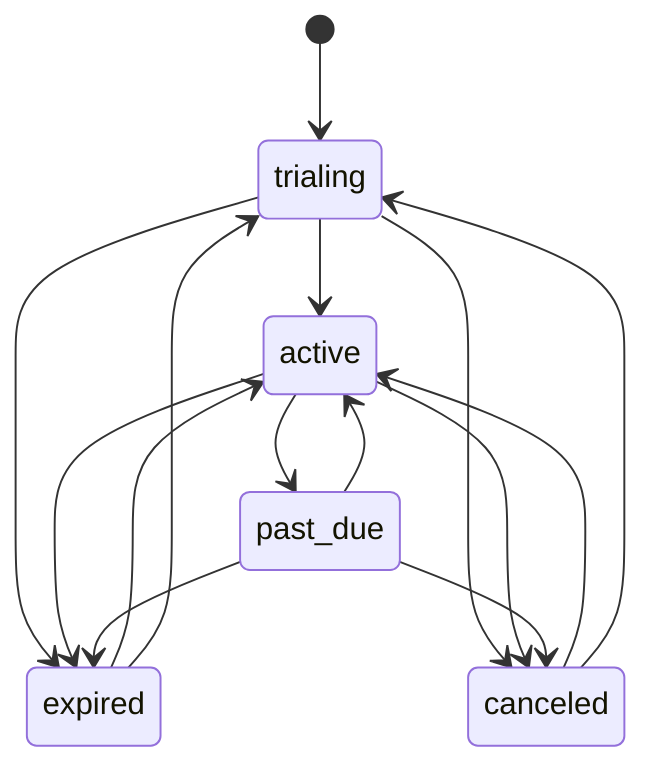

## paymentSubmission — `payment_submissions.status`

Initial: `pending`. Terminal: `approved`, `rejected`.

Written by: `app/api/payments/manual/route.ts (insert pending)`, `cyreax_review_payment() SQL (locks row, pending only)`

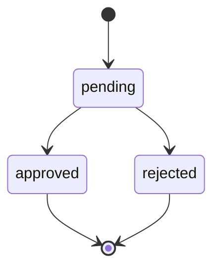

## paymentIntent — `payment_intents.status`

Initial: `pending`. Terminal: `paid`, `cancelled`, `failed`.

Written by: `lib/commerce/intents.ts (compare-and-set on pending)`

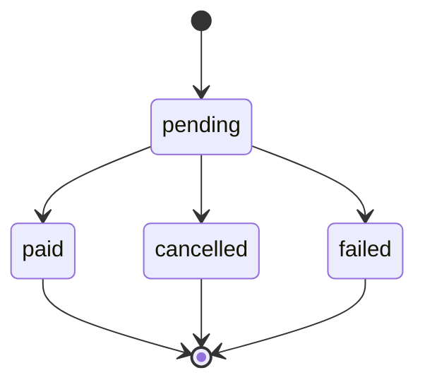

## order — `orders.status`

Initial: `pending_payment`. Terminal: `cancelled`, `refunded`.

Written by: `lib/commerce/checkout.ts markOrderFromProvider (guarded)`

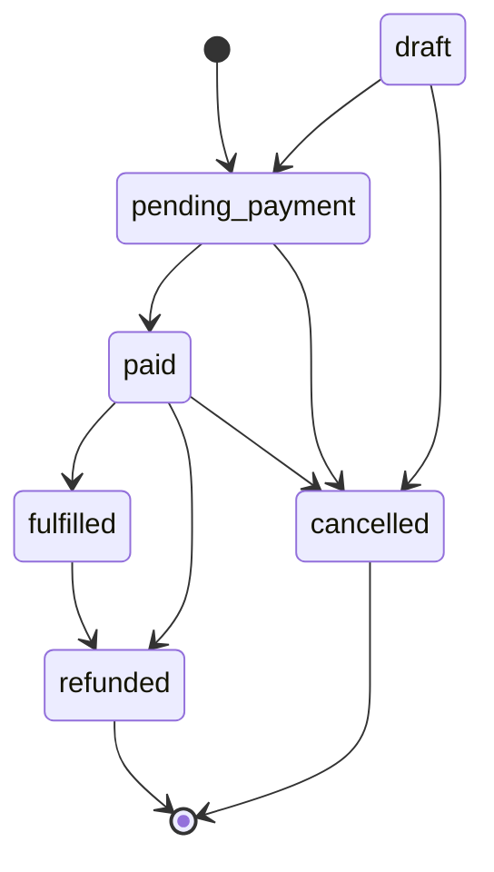

## clientInvoice — `client_invoices.status`

Initial: `open`. Terminal: `paid`, `void`.

Written by: `app/api/agency/invoices/route.ts`, `app/api/payments/{paymob,tap}`, `app/api/cron/dunning/route.ts`

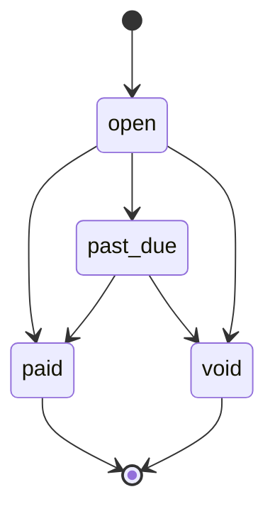

## supportTicket — `support_tickets.status`

Initial: `open`. Terminal: none.

Written by: `app/api/support/tickets/[id]/route.ts (guarded)`

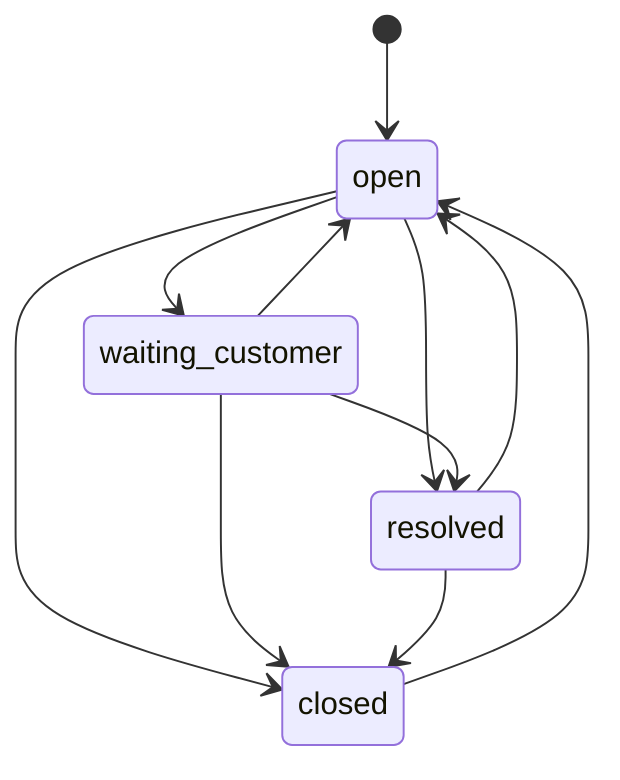

## inboundEvent — `inbound_events.status`

Initial: `pending`. Terminal: `done`, `dead`.

Written by: `lib/inbound-queue.ts (insert)`, `claim_inbound_events() SQL`, `lib/inbound-worker.ts (backoff, dead after 5)`

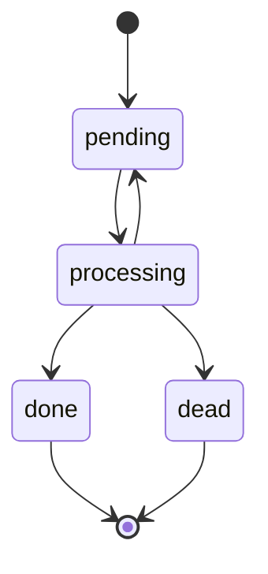

## flowJob — `flow_jobs.status`

Initial: `pending`. Terminal: `done`, `dead`, `cancelled`.

Written by: `lib/flows/runtime.ts`

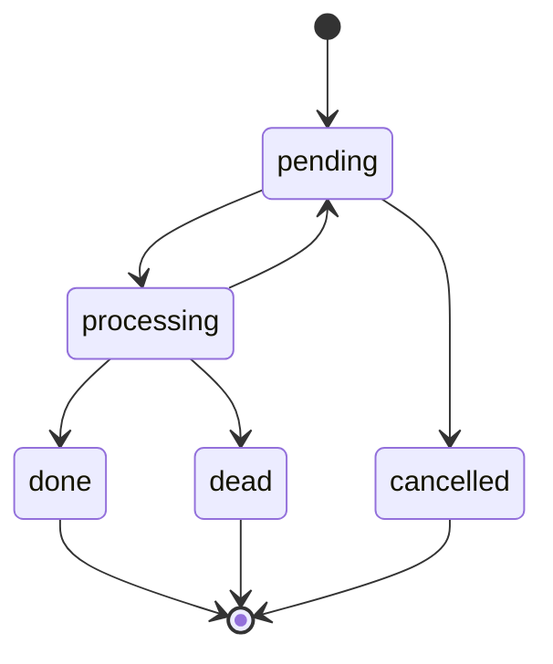

## outgoingWebhookDelivery — `outgoing_webhook_deliveries.status`

Initial: `pending`. Terminal: `done`, `dead`.

Written by: `lib/integrations/drain.ts`

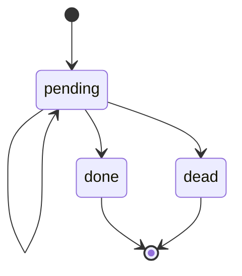

## flow — `flows.status`

Initial: `draft`. Terminal: none.

Written by: `app/api/flows/[id]/route.ts`, `app/api/flows/[id]/publish/route.ts`

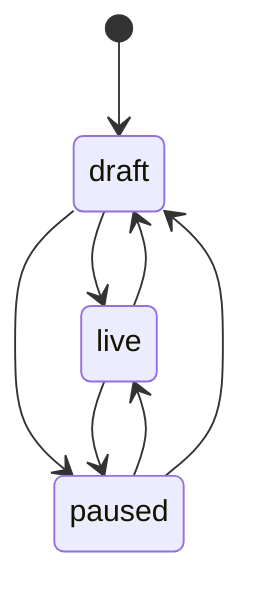

## sequence — `sequences.status`

Initial: `draft`. Terminal: none.

Written by: `app/api/sequences/route.ts`

## flowRun — `flow_runs.status`

Initial: `active`. Terminal: `completed`, `failed`, `opted_out`.

Written by: `lib/flows/engine.ts`, `lib/flows/runtime.ts`

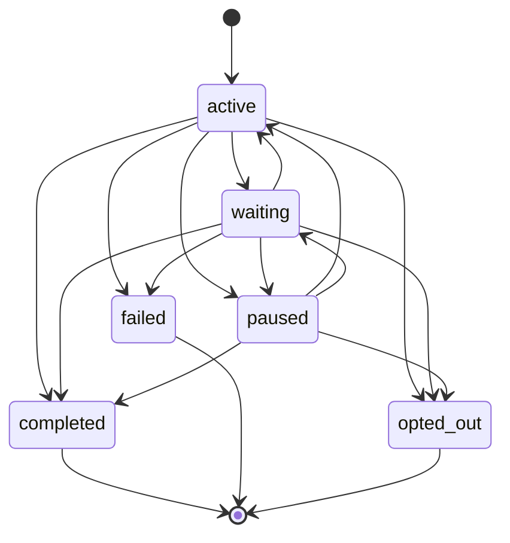

## broadcast — `broadcasts.status`

Initial: `draft`. Terminal: `sent`, `cancelled`.

Written by: `app/api/broadcasts/route.ts`, `lib/flows/runtime.ts`

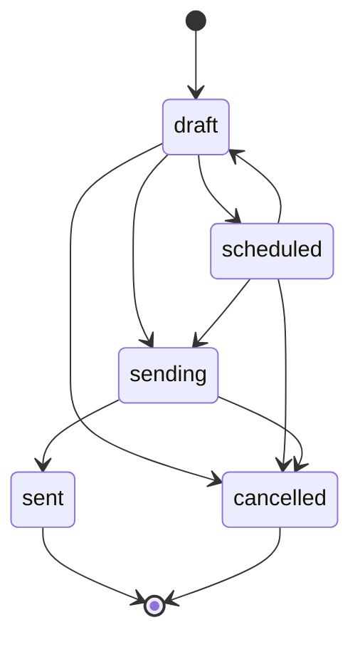

## emailCampaign — `email_campaigns.status`

Initial: `draft`. Terminal: `completed`.

Written by: `app/api/admin/campaigns/**`, `lib/campaign-sender.ts`, `app/api/cron/send-scheduled-campaigns/route.ts`

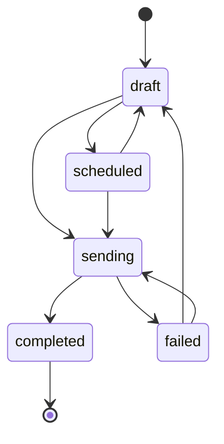

## giveaway — `giveaways.status`

Initial: `open`. Terminal: `closed`.

Written by: `app/api/growth/route.ts`

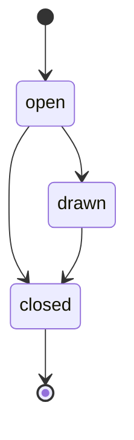

## teamInvite — `agency_team_members.status`

Initial: `invited`. Terminal: `active`.

Written by: `app/api/team/route.ts`, `app/api/team/accept/route.ts`

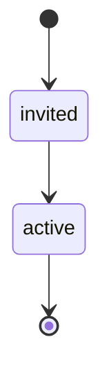
